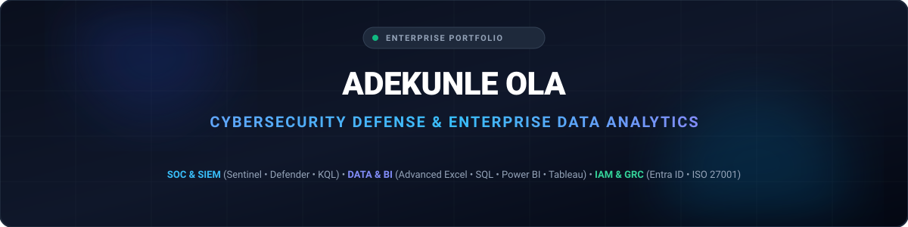

  

  

  
  
  
  

---

## 👨‍💻 Professional Profile

I am a **Cybersecurity Analyst and Data Analysis Specialist** dedicated to bridging technical threat telemetry with evidence-based business intelligence. I apply analytical thinking, threat research, and automated data pipelines to solve complex business and enterprise security challenges.

My operational competencies span **Identity & Access Management (IAM), Governance, Risk & Compliance (GRC), Security Operations Center (SOC) defense, Threat Modeling, Threat Intelligence, and Enterprise BI Modeling**.

Through hands-on operational assignments at **Halisans Technologies**, I have developed practical expertise in enterprise identity lifecycle management, threat hunting, detection engineering, and access recertification across hybrid Active Directory and Microsoft Entra ID environments.

---

## 💼 Practical Experience | Halisans Technologies

**Role:** Cybersecurity Analyst (SOC, IAM & GRC)  
**Period:** 2026 – Present  
**Environment:** Cybersecurity Operations, Identity Governance & Risk Management

### Core Operational Responsibilities by Domain:

#### 🛡️ Security Operations Center (SOC)
- **Authentication Alert Investigation:** Investigated Windows Event IDs `4624`, `4625`, and `4740` using KQL in Microsoft Sentinel, isolating brute force and password spraying anomalies.
- **Defender Endpoint Triage:** Analyzed endpoint telemetry in Microsoft Defender for Endpoint, evaluated process execution trees, extracted indicators, and initiated host containment.
- **Sentinel Automation Playbooks:** Built automated incident response playbooks in Azure Logic Apps triggered upon alert creation for rapid ticket dispatch and account isolation.
- **SOC Monitoring Workbooks:** Created interactive Sentinel dashboards visualizing authentication anomalies and Mean Time to Triage (MTTT) metrics.

#### 🔑 Identity & Access Management (IAM)
- **Joiner–Mover–Leaver (JML) Workflow:** Formulated and documented identity lifecycle workflows governing provisioning, mover role transitions, and deprovisioning with auditable ticket closure trails.
- **Enterprise RBAC & Least Privilege:** Designed an enterprise Role-Based Access Control (RBAC) entitlement matrix enforcing strict Separation of Duties (SoD) aligned with **ISO/IEC 27001:2022 Control A5.18**.
- **Directory Administration:** Implemented and tested Active Directory and Microsoft Entra ID identity configurations, GPOs, and secure access policies.
- **Quarterly User Access Reviews (UAR):** Conducted entitlement recertification reviews across directory services, flagging access creep and tracking remediation.

#### 📋 Governance, Risk & Compliance (GRC)
- **Enterprise Risk Assessment:** Maintained operational risk registers evaluating threats, likelihood, and business impact to compute inherent and residual risk ratings.
- **ISO 27001 Control Assessment:** Mapped organizational controls against ISO/IEC 27001:2022 Annex A, identified gaps, and developed corrective action plans.
- **Policy & Procedure Development:** Formulated access control, acceptable use, and incident response governance documentation.
- **Audit Evidence & Exception Tracking:** Built an auditable evidence index, tested control operational effectiveness, and tracked audit exceptions to closure.

#### 🕵️ Threat Intelligence & Security Analysis
- **Threat Intelligence Assessment:** Ingested and evaluated tactical intelligence pulses from AlienVault OTX and SOCRadar, validating indicator fidelity and local relevance.
- **IOC-to-Detection Handoff:** Translated validated threat actor hypotheses (e.g., LockBit 3.0, APT29) into operational KQL detection rules for deployment to Sentinel.
- **MITRE ATT&CK Mapping:** Deconstructed adversary tactics and techniques across the MITRE ATT&CK Enterprise Matrix, separating evidence from assumptions.

---

## ⭐ Featured Production Case Studies

My technical projects are organized into two dedicated, independent repositories:

### 🛡️ [Cybersecurity & SOC/IAM/GRC Portfolio](https://github.com/Adekunle-sec/cybersecurity-portfolio)

| Case Study | Domain | Primary Toolset | Key Outcomes & Takeaways |
|:---|:---|:---|:---|
| **[Authentication Alert Investigation](https://github.com/Adekunle-sec/cybersecurity-portfolio/tree/main/halisans-operations/SOC/case-studies/01-authentication-alert-investigation)** | SOC / SIEM | Microsoft Sentinel, KQL | Investigated brute-force password spraying; correlated Event ID `4625` threshold anomalies; reduced MTTT to < 3 min |
| **[Joiner-Mover-Leaver Workflow](https://github.com/Adekunle-sec/cybersecurity-portfolio/tree/main/halisans-operations/IAM/case-studies/01-joiner-mover-leaver-workflow)** | IAM Lifecycle | Entra ID, Active Directory | Documented authorized provisioning, mover changes, and time-bound deactivation procedures |
| **[RBAC & Least Privilege Matrix](https://github.com/Adekunle-sec/cybersecurity-portfolio/tree/main/halisans-operations/IAM/case-studies/03-rbac-and-least-privilege)** | IAM / Governance | Entra ID, RBAC | Designed least-privilege matrix; enforced Separation of Duties (SoD); aligned to ISO 27001 Control A5.18 |
| **[Enterprise Risk Assessment](https://github.com/Adekunle-sec/cybersecurity-portfolio/tree/main/halisans-operations/GRC/case-studies/01-enterprise-risk-assessment)** | GRC / Risk | Risk Registers, NIST CSF | Modeled threat likelihood, business impact, treatment strategies, and residual risk scores |
| **[ISO 27001 Control Assessment](https://github.com/Adekunle-sec/cybersecurity-portfolio/tree/main/halisans-operations/GRC/case-studies/02-iso-27001-control-assessment)** | GRC / Compliance | ISO 27001:2022 Annex A | Mapped control requirements to evidence, identified control gaps, and formulated remediation plans |
| **[Threat Intelligence & MITRE Hunting](https://github.com/Adekunle-sec/cybersecurity-portfolio/tree/main/halisans-operations/Security-Analysis/case-studies/01-threat-intelligence-assessment)** | CTI / Threat Hunting | MITRE ATT&CK, OTX, VirusTotal | Ingested CTI pulses (LockBit 3.0, APT29); converted IOC hashes to Sentinel automated detection rules |
| **[Automated SOAR Playbooks](https://github.com/Adekunle-sec/cybersecurity-portfolio/tree/main/labs/04-soar-sentinel-playbooks)** | SOAR / Automation | Azure Logic Apps, Sentinel | Automated host isolation, compromised credential invalidation, and Tier-2 analyst Jira dispatch |

### 📊 [Enterprise Data Analytics & BI Portfolio](https://github.com/Adekunle-sec/data-analytics-portfolio)

| Project | Domain | Primary Toolset | Key Outcomes & Deliverables |
|:---|:---|:---|:---|
| **[Operations & Supply Chain Modeling](https://github.com/Adekunle-sec/data-analytics-portfolio/tree/main/projects/01-excel-operations-analytics)** | Advanced Excel | Power Query, Dynamic Arrays | Modeled 32,245 operational records across 47 sheets; automated Turnaround Time (TAT) velocity & QC pass rate |
| **[Production SQL Cleaning & EDA](https://github.com/Adekunle-sec/data-analytics-portfolio/tree/main/projects/02-sql-data-cleaning-and-eda)** | SQL Engineering | T-SQL, PostgreSQL, CTEs | AlexTheAnalyst benchmark; self-joins for NULL imputation, `PARSENAME` tokenization, window rolling sums |
| **[Executive BI & DAX Modeling](https://github.com/Adekunle-sec/data-analytics-portfolio/tree/main/projects/03-powerbi-executive-dashboard)** | Power BI | Star Schema, 25+ DAX Measures | Production star schema (Fact + 4 Dims); Time Intelligence (`YTD`, `SAMEPERIODLASTYEAR`); Pareto 80/20 analysis |
| **[Operational Storyboard & LOD](https://github.com/Adekunle-sec/data-analytics-portfolio/tree/main/projects/04-tableau-telemetry-storyboard)** | Tableau Public | LOD Expressions, Geo Maps | Level of Detail (`{FIXED [Region] : AVG()}`) calculations; dual-axis geospatial routing choke points |

---

## 📑 Evidence & Documentation Standards

> [!NOTE]
> **Confidentiality:** No real credentials, tokens, internal IPs, customer data, sensitive alerts, personal identifiers, or unapproved screenshots. Use synthetic or redacted evidence. Publish only materials approved for external sharing.

Every case study across my repositories is maintained to strict international standards:

1. **Operational Transparency:** All documented exercises distinguish between authorized operational implementations, supervised team activities at Halisans Technologies, and independent lab environments.
2. **Confidentiality & Non-Disclosure:** Strict adherence to data privacy and security ethics. No live corporate credentials, personal identifiers, internal network IPs, proprietary customer records, or internal escalation tokens are published. All datasets are synthetic, redacted, or sanitized.
3. **Audit-Ready Structure:** Every project contains a structured breakdown including:
   - Defined Scenario & Problem Statement
   - Scope, Boundary & Authorization Details
   - Step-by-Step Technical Methodology
   - Sanitized Evidence Artifacts (queries, scripts, matrices)
   - Quantified Business / Security Outcomes
   - Technical Limitations & Lessons Learned

---

## 🎓 Certifications & Professional Development

### Industry Frameworks & Standards:
* **MITRE ATT&CK Enterprise Matrix v14**: Threat modeling, technique decomposition, and detection engineering.
* **ISO/IEC 27001:2022**: Information security management systems, ITGC control testing, and audit preparation.
* **NIST Cybersecurity Framework (CSF 2.0)**: Identify, Protect, Detect, Respond, Recover lifecycle.
* **Zero-Trust Architecture (ZTA)**: Explicit verification, least-privileged access, and assume breach philosophy.

### Continuous Technical Competencies:
* **Cloud SIEM & Threat Hunting:** Microsoft Sentinel, Microsoft Defender XDR, KQL (Kusto Query Language), Splunk.
* **Enterprise Identity (IAM):** Microsoft Entra ID (Azure AD), Windows Server Active Directory, Group Policy (GPO), RBAC, JML.
* **Governance & Risk:** Risk Registers, ITGC Controls, Audit Exception Tracking, Jira Service Desk.
* **Data Engineering & Analytics:** Advanced Microsoft Excel (Power Query, Dynamic Arrays, Financial/Ops Modeling), T-SQL, PostgreSQL, Power BI (DAX), Tableau Public.

---

## 📈 GitHub Analytics & Activity

  
  

---

## 🤝 Let's Connect

I am actively seeking roles and high-impact opportunities in **Cybersecurity (Cybersecurity Analyst, SOC Analyst, Threat Intelligence, IAM/GRC Analyst)** and **Data Analysis (Enterprise Data & BI Analyst)**.

* 💼 **LinkedIn:** [linkedin.com/in/adekunle-olanrewaju-20261844b](https://www.linkedin.com/in/adekunle-olanrewaju-20261844b)
* 📧 **Email:** [tayour.ola@gmail.com](mailto:tayour.ola@gmail.com)
* 🛡️ **Cybersecurity Codebase:** [Adekunle-sec / cybersecurity-portfolio](https://github.com/Adekunle-sec/cybersecurity-portfolio)
* 📊 **Data Analytics Codebase:** [Adekunle-sec / data-analytics-portfolio](https://github.com/Adekunle-sec/data-analytics-portfolio)
* 📍 **Location:** Lagos, Nigeria · Open to Global Remote, Hybrid, or Relocation opportunities

  Precision-Engineered • Evidence-Backed • International Industry Standards

