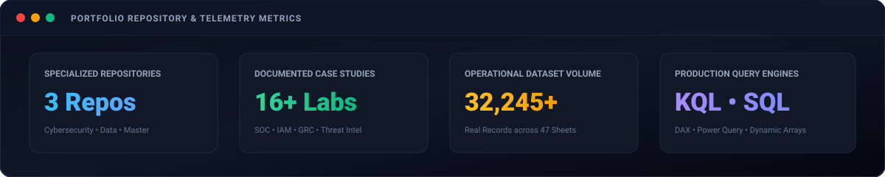

  

  

  
  
  
  

---

## 👨‍💻 Professional Profile

I am a **Cybersecurity Analyst and Data Analysis Specialist** dedicated to bridging technical threat telemetry with evidence-based business intelligence. I apply analytical thinking, threat research, and automated data pipelines to solve complex business and enterprise security challenges.

My operational competencies span **Identity & Access Management (IAM), Governance, Risk & Compliance (GRC), Security Operations Center (SOC) defense, Threat Modeling, Threat Intelligence, and Enterprise BI Modeling**.

Through hands-on operational assignments at **Halisans Technologies**, I have developed practical expertise in enterprise identity lifecycle management, threat hunting, detection engineering, and access recertification across hybrid Active Directory and Microsoft Entra ID environments.

---

## 💼 Practical Experience | Halisans Technologies

**Role:** Cybersecurity Analyst (SOC, IAM & GRC)  
**Period:** 2026 – Present  
**Environment:** Cybersecurity Operations, Identity Governance & Risk Management

### Core Operational Responsibilities by Domain:

#### 🛡️ Security Operations Center (SOC) & SIEM
- **Event vs. Alert vs. Incident Triage:** Standardized triage methodologies distinguishing baseline telemetry events from automated system alerts and confirmed security incidents requiring containment.
- **SIEM & XDR Defense-in-Depth:** Correlated tactical endpoint detections in Microsoft Defender XDR with enterprise surveillance feeds across Microsoft Sentinel, Splunk, and Linux servers.
- **Multi-OS Device Onboarding (Azure Arc & AMA):** Deployed Azure Arc onboarding scripts (`OnboardAzureArc.sh` / `OnboardAzureArc.ps1`), verified agent telemetry with `azcmagent show`, and configured Data Collection Rules (DCR) via XPath filtering (`EventID 4624, 4625, 4740`).
- **Authentication & Kerberos Analysis:** Analyzed Kerberos ticket-granting security mechanics (AS authentication, TGT issuance, TGS ticket exchange), investigating brute-force and password spraying attacks.
- **Custom Indicator Blocking & SOAR:** Added malicious file hashes directly to Microsoft Defender custom block lists (`Indicators -> File hashes -> Block execution`) and built automated Logic App playbooks for instant host isolation.

#### 🔑 Identity & Access Management (IAM) & Governance
- **Enterprise Provisioning & Entitlement Matrices:** Provisioned user identities in Microsoft Entra ID and Active Directory based on standardized RBAC entitlement matrices and GRC compliance standards.
- **Multi-Factor Authentication (MFA) Defense Layering:** Enforced 3-pillar authentication policies combining *what you know* (passcodes), *what you are* (biometrics), and *what you have* (hardware tokens / authenticator apps).
- **Administrative Role Segregation:** Configured granular role permissions in Microsoft Defender XDR (`Defender -> config -> permission -> roles`) isolating SOC Manager, SOC Tier 1, and SOC Tier 2 duties; provisioned Sentinel Resource Group IAM permissions.
- **Identity Governance & JML Lifecycle:** Managed Jira Service Desk account provisioning, department group assignments, automated Defender incident email notifications (aligned with **ISO 27001 Control A5.18**), and quarterly access recertifications.

#### 📋 Governance, Risk & Compliance (GRC) & Audit Readiness
- **Enterprise Risk Assessment:** Maintained operational risk registers evaluating threats, likelihood, and business impact to compute inherent and residual risk ratings.
- **ISO/IEC 27001:2022 Control Assessments:** Mapped technical operations against Annex A controls, including Control A5.7 (Threat Intelligence), Control A5.18 (Access Rights), and Controls A8.15 & A8.16 (Logging & Monitoring).
- **Audit Evidence Delivery:** Packaged auditable proof of user creation, group memberships, and role assignments, validating compliance against organizational governance rules.
- **Policy & Procedure Development:** Formulated access control, acceptable use, and incident response governance documentation.

#### 🕵️ Threat Intelligence & Security Analysis
- **IOA vs. IOC Threat Hunting:** Hunted for pre-attack behavioral indicators of attack (IOAs) and post-incident indicators of compromise (IOCs: IPs, SHA-256 hashes, domains, DKIM/DMARC/SPF anomalies).
- **Intelligence Gathering & Validation:** Ingested threat pulses and reports from AlienVault OTX (Pulses, Groups, Users), SOCRadar, and VirusTotal; verified binary digital signatures to identify unsigned malware.
- **Threat Actor Profiling & MITRE ATT&CK:** Deconstructed adversary tactics and techniques across the MITRE ATT&CK Enterprise Matrix (e.g., APT29, LockBit 3.0, Lazarus Group; T1190, T1566) into actionable Sentinel KQL detection rules.

---

## ⭐ Featured Production Case Studies

My technical projects are organized into two dedicated, independent repositories:

### 🛡️ [Cybersecurity Portfolio (Unified Monorepo)](https://github.com/Adekunle-sec/cybersecurity-portfolio)

| Case Study / Project | Domain | Primary Toolset | Key Outcomes & Takeaways |
|:---|:---|:---|:---|
| **[Threat Modeling & Risk Assessment for a SaaS Product](https://github.com/Adekunle-sec/cybersecurity-portfolio/tree/main/SOC/threat-modeling-risk-assessment-saas)** | Threat Modeling & Risk | OWASP Threat Dragon, STRIDE, ISO 27001, NIST 800-53 | Complete DFD (L1), 1,000-row STRIDE risk register, mitigation plan, control mapping matrix, and 24-page threat model report |
| **[Authentication Alert Investigation](https://github.com/Adekunle-sec/cybersecurity-portfolio/tree/main/SOC/case-studies/01-authentication-alert-investigation)** | SOC / SIEM | Microsoft Sentinel, KQL | Investigated brute-force password spraying; correlated Event ID `4625` threshold anomalies; reduced MTTT to < 3 min |
| **[Joiner-Mover-Leaver Workflow](https://github.com/Adekunle-sec/cybersecurity-portfolio/tree/main/IAM/case-studies/01-joiner-mover-leaver-workflow)** | IAM Lifecycle | Entra ID, Active Directory | Documented authorized provisioning, mover changes, and time-bound deactivation procedures |
| **[RBAC & Least Privilege Matrix](https://github.com/Adekunle-sec/cybersecurity-portfolio/tree/main/IAM/case-studies/03-rbac-and-least-privilege)** | IAM / Governance | Entra ID, RBAC | Designed least-privilege matrix; enforced Separation of Duties (SoD); aligned to ISO 27001 Control A5.18 |
| **[Enterprise Risk Assessment](https://github.com/Adekunle-sec/cybersecurity-portfolio/tree/main/GRC/case-studies/01-enterprise-risk-assessment)** | GRC / Risk | Risk Registers, NIST CSF | Modeled threat likelihood, business impact, treatment strategies, and residual risk scores |
| **[ISO 27001 Control Assessment](https://github.com/Adekunle-sec/cybersecurity-portfolio/tree/main/GRC/case-studies/02-iso-27001-control-assessment)** | GRC / Compliance | ISO 27001:2022 Annex A | Mapped control requirements to evidence, identified control gaps, and formulated remediation plans |
| **[Threat Intelligence & MITRE Hunting](https://github.com/Adekunle-sec/cybersecurity-portfolio/tree/main/SOC/threat-intelligence-and-detection/case-studies/01-threat-intelligence-assessment)** | CTI / Threat Hunting | MITRE ATT&CK, OTX, VirusTotal | Ingested CTI pulses (LockBit 3.0, APT29); converted IOC hashes to Sentinel automated detection rules |
| **[Automated SOAR Playbooks](https://github.com/Adekunle-sec/cybersecurity-portfolio/tree/main/SOC/labs/04-soar-sentinel-playbooks)** | SOAR / Automation | Azure Logic Apps, Sentinel | Automated host isolation, compromised credential invalidation, and Tier-2 analyst Jira dispatch |

### 📊 [Enterprise Data Analytics & BI Portfolio](https://github.com/Adekunle-sec/data-analytics-portfolio)

| Project | Domain | Primary Toolset | Key Outcomes & Deliverables |
|:---|:---|:---|:---|
| **[Operations & Supply Chain Modeling](https://github.com/Adekunle-sec/data-analytics-portfolio/tree/main/projects/01-excel-operations-analytics)** | Advanced Excel | Power Query, Dynamic Arrays | Modeled 32,245 operational records across 47 sheets; automated Turnaround Time (TAT) velocity & QC pass rate |
| **[Production SQL Cleaning & EDA](https://github.com/Adekunle-sec/data-analytics-portfolio/tree/main/projects/02-sql-data-cleaning-and-eda)** | SQL Engineering | T-SQL, PostgreSQL, CTEs | AlexTheAnalyst benchmark; self-joins for NULL imputation, `PARSENAME` tokenization, window rolling sums |
| **[Executive BI & DAX Modeling](https://github.com/Adekunle-sec/data-analytics-portfolio/tree/main/projects/03-powerbi-executive-dashboard)** | Power BI | Star Schema, 25+ DAX Measures | Production star schema (Fact + 4 Dims); Time Intelligence (`YTD`, `SAMEPERIODLASTYEAR`); Pareto 80/20 analysis |
| **[Operational Storyboard & LOD](https://github.com/Adekunle-sec/data-analytics-portfolio/tree/main/projects/04-tableau-telemetry-storyboard)** | Tableau Public | LOD Expressions, Geo Maps | Level of Detail (`{FIXED [Region] : AVG()}`) calculations; dual-axis geospatial routing choke points |

---

## 📑 Evidence & Documentation Standards

> [!NOTE]
> **Confidentiality:** No real credentials, tokens, internal IPs, customer data, sensitive alerts, personal identifiers, or unapproved screenshots. Use synthetic or redacted evidence. Publish only materials approved for external sharing.

Every case study across my repositories is strictly my personal experience:

1. **Operational Transparency:** All documented exercises distinguish between authorized operational implementations, supervised team activities at Halisans Technologies, and independent lab environments.
2. **Confidentiality & Non-Disclosure:** Strict adherence to data privacy and security ethics. No live corporate credentials, personal identifiers, internal network IPs, proprietary customer records, or internal escalation tokens are published. All datasets are synthetic, redacted, or sanitized.
3. **Audit-Ready Structure:** Every project contains a structured breakdown including:
   - Defined Scenario & Problem Statement
   - Scope, Boundary & Authorization Details
   - Step-by-Step Technical Methodology
   - Sanitized Evidence Artifacts (queries, scripts, matrices)
   - Quantified Business / Security Outcomes
   - Technical Limitations & Lessons Learned

---
### 🎓 Certifications

### Professional Development

### Industry Frameworks & Standards:
* **MITRE ATT&CK Enterprise Matrix v14**: Threat modeling, technique decomposition, and detection engineering (T1190, T1566).
* **ISO/IEC 27001:2022**: Information security management systems, Annex A controls (A5.7 Threat Intel, A5.18 Access Rights, A8.15 & A8.16 Logging & Monitoring).
* **NIST Cybersecurity Framework (CSF 2.0)**: Identify, Protect, Detect, Respond, Recover lifecycle.
* **NIST SP 800-53 Rev 5 & Zero-Trust Architecture (ZTA)**: Explicit verification, least-privilege access, and assume-breach philosophy.

### Continuous Technical Competencies:
* **Cloud SIEM & Threat Hunting:** Microsoft Sentinel, Microsoft Defender XDR, Splunk, Wazuh, Elastic, Gurucul (AI UEBA), KQL (Kusto Query Language), Azure Arc, Azure Monitor Agent (AMA).
* **Enterprise Identity & Access Governance:** Microsoft Entra ID (Azure AD), Windows Server Active Directory, MFA Layering (Knowledge, Biometrics, FIDO2/Tokens), RBAC Entitlement Matrices, Defender Role Segregation, Jira Provisioning.
* **Threat Modeling & CTI:** OWASP Threat Dragon, STRIDE, AlienVault OTX, SOCRadar, VirusTotal, Filigran (OpenCTI), abuse.ch, MITRE ATT&CK.
* **Governance, Risk & Compliance (GRC):** Enterprise Risk Registers, CVSS v3.1 Scoring, Statement of Applicability (SoA), ITGC Control Testing, Audit Exception Tracking.
* **Data Engineering & Analytics:** Advanced Microsoft Excel (Operation Analyst, Dynamic Arrays, Financial/Ops Modeling), SQL (T-SQL, PostgreSQL), Power BI (DAX, Star Schema), Tableau Public.

---

## 📈 Technical Portfolio Metrics & Telemetry

  

---

## 🤝 Let's Connect

I am actively seeking roles and high-impact opportunities in **Cybersecurity (Cybersecurity Analyst, SOC Analyst, Threat Intelligence, IAM/GRC Analyst)**.

* 💼 **LinkedIn:** [linkedin.com/in/adekunle-olanrewaju-20261844b](https://www.linkedin.com/in/adekunle-olanrewaju-20261844b)
* 📧 **Email:** [tayour.ola@gmail.com](mailto:tayour.ola@gmail.com)
* 🛡️ **Cybersecurity Codebase:** [Adekunle-sec / cybersecurity-portfolio](https://github.com/Adekunle-sec/cybersecurity-portfolio)
* 📊 **Data Analytics Codebase:** [Adekunle-sec / data-analytics-portfolio](https://github.com/Adekunle-sec/data-analytics-portfolio)
* 📍 **Location:** Lagos, Nigeria · Open to Global Remote, Hybrid, or Relocation opportunities

  Precision-Engineered • Evidence-Backed • International Industry Standards

